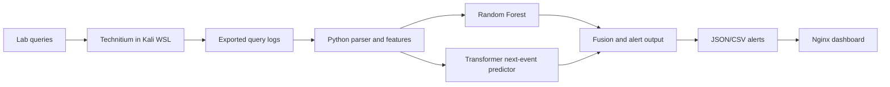

# DNS Anomaly Detection Lab

A learning project that analyzes Technitium DNS query logs with two complementary models:

1. A **supervised Random Forest** estimates whether a query resembles labeled attacks.
2. An **unsupervised Transformer next-event predictor** learns from benign DNS sequences and assigns higher prediction error to queries that do not fit the client's recent behavior.

The final alert is raised if either model crosses its threshold. Each output row includes both scores and the reason. This is a lab detector for investigation and learning; it does not automatically block DNS traffic.

## Architecture



Technitium and Nginx run as containers started from Kali WSL. The Python models run in a virtual environment in Kali WSL. Technitium's DNS port is published as `5353` on the WSL side to avoid taking over WSL's normal DNS port `53`; use `dig -p 5353` when making practice queries. The dashboard is published on `127.0.0.1:8088` and the Technitium web console on `127.0.0.1:5380`, so these lab services are reachable locally.

## 1. Prepare Kali WSL and Docker

Keep the project in Kali's Linux home directory (for example, `~/dns-anomaly-lab`) rather than under `/mnt/c`; this makes model and container file access faster. Install Docker Desktop for Windows with its WSL 2 backend, then enable **Settings → Resources → WSL Integration → Kali**. Docker commands from Kali will then start the project's containers. Docker's official setup guide documents this integration: [Docker Desktop with WSL 2](https://docs.docker.com/desktop/features/wsl/).

Check that Docker is reachable from Kali:

```bash
docker version
docker compose version
```

Start Technitium and Nginx. Compose will pull the Technitium image automatically if it is not already downloaded:

```bash
docker compose -f infra/docker-compose.yml up -d
docker compose -f infra/docker-compose.yml ps
```

Open the Technitium console in your Windows browser at `http://localhost:5380`. Technitium's default first-run login is `admin` / `admin` and the console may auto-login; change that default after you finish the lab setup. Add and enable a query logging app before collecting logs. Technitium documents this default login and recommends changing it on first use: [Technitium DNS](https://technitium.com/dns/). The DNS service is reachable from Kali at `127.0.0.1:5353`.

Install `dig` and make a practice DNS query through the local Technitium server:

```bash
sudo apt install -y dnsutils
dig @127.0.0.1 -p 5353 example.com
```

The custom port is for this WSL lab. To make other devices on your network use this DNS server, you would need a separate network-facing setup with port 53 and WSL networking/firewall configuration.

## 2. Prepare Python in Kali WSL

From this project directory:

```bash
python3 --version
python3 -m venv .venv
source .venv/bin/activate
python -m pip install --upgrade pip
python -m pip install torch --index-url https://download.pytorch.org/whl/cpu
pip install -r requirements.txt
pip install -e .
```

The Transformer uses PyTorch on CPU. Installing from the CPU-only PyTorch index avoids downloading CUDA/GPU packages; this lab does not need a GPU. Training can take a little time on a CPU.

## 3. Generate practice data and train once

The synthetic dataset is only for learning the command flow. Its attack labels come directly from the data generator's scenario, not from a detection rule.

```bash
dns-detect demo-data --out data/raw/demo.csv --count 1200
dns-detect train --input data/raw/demo.csv
```

Training writes:

- `models/rf_bundle.joblib` — Random Forest, feature scaler, and Transformer threshold.
- `models/transformer.pt` — Transformer predictor parameters.
- `reports/training_report.json` — held-out Random Forest metrics and Transformer calibration information.

## 4. Score practice data

```bash
dns-detect detect --input data/raw/demo.csv
```

Outputs:

- `reports/alerts.json` — full event details, scores, decisions, and reasons.
- `reports/alerts.csv` — spreadsheet-friendly version.

The Random Forest default alert threshold is `0.65`. The Transformer threshold is calibrated from a reserved portion of benign training sequences. Both are adjustable in `src/dns_detect/pipeline.py` and `src/dns_detect/cli.py`.

## 5. Run the tests

From the project directory with `.venv` activated:

```bash
python -m unittest discover -s tests -v
```

The tests check log field normalization, feature calculations, per-client sequence handling, the Technitium API request against a local mock server, and an end-to-end demo training/detection run.

## 6. Collect query logs from Technitium

The project includes a read-only Technitium API collector. Technitium's `/api/logs/export` API exports CSV for a selected DNS query-log app. Install and enable a query logging app first (for example, the Query Logs app), then create an API token that has **Logs: View** permission. This starter does not change your DNS settings.

Technitium is in the same Kali WSL environment, so its API address is `localhost` on port `5380`. Enter the token without putting it in shell history:

Run this file for collecting log from technitium.After run it you need to past the API_Key of technitium.

Noted: For this data is using Query Logs (Sqlite).

```
./scripts/collect_technitium.sh
```

The command prints the output path if the API returns CSV. If it reports an app or class-path error, copy the exact app details shown by your installed DNS app. The API endpoint is documented by Technitium as exporting logs for a specified DNS app, with a downloadable CSV response. See [Technitium API documentation](https://github.com/TechnitiumSoftware/DnsServer/blob/master/APIDOCS.md).

## 7. Train and score the collected data

The CSV log export has no ground-truth attack labels by default. For training, add a `label` column (`benign` or `attack`) based on controlled lab scenarios and known time/client ranges. Keep labels independent of model alerts. The detection file does not need labels.

```bash
dns-detect train --input data/raw/technitium_labeled.csv
dns-detect detect --input data/raw/technitium.csv
```

This starter accepts **CSV, JSON, or JSONL**. It recognizes common aliases for these fields:

| Normalized field | Example aliases | Needed for |
|---|---|---|
| `timestamp` | `timestamp`, `time`, `date` | Sequence and time-window features |
| `client_ip` | `client_ip`, `client`, `source` | Per-client sequence features |
| `domain` | `domain`, `query`, `qname`, `name` | Required |
| `query_type` | `query_type`, `type`, `qtype` | Feature extraction |
| `response_code` | `response_code`, `rcode`, `status` | NXDOMAIN feature |
| `label` | `label`, `class`, `ground_truth` | Training only |

The log parser automatically normalizes recognized header names. For a different Technitium format, convert it to CSV/JSON with the fields above before running the detector. Keep events in timestamp order and retain the original client IP and query name.

For **training**, include a `label` column with `benign` or `attack`. Assign attack labels from the controlled test scenario and its known time/client range. Do not derive labels from model output, anomaly scores, or the number of detections. For **detection**, the label column is not required.

Example:

```csv
timestamp,client_ip,domain,query_type,response_code,label
2026-10-26T10:00:00Z,192.168.20.25,portal.lab.test,A,NOERROR,benign
2026-10-26T10:00:02Z,192.168.20.25,updates.lab.test,A,NOERROR,benign
```

The training file must contain both classes, with both benign and attack examples present in its first 75% of timestamp-ordered rows. Keep attack scenarios distributed over time so the chronological holdout contains representative traffic.

## 8. Serve the alert dashboard with Nginx

Nginx was started in step 1. After running detection and creating `reports/alerts.json`, open the dashboard in your Windows browser at `http://localhost:8088`:

```bash
docker compose -f infra/docker-compose.yml restart dashboard
```

The dashboard displays the latest 200 events. It refreshes when the page is reloaded.

The dashboard uses port `8088`. Do not expose the dashboard or Technitium's web console outside your isolated lab unless you add authentication and access controls.

## What each source file does

- `src/dns_detect/cli.py` — commands for demo data, training, and detection.
- `src/dns_detect/collector.py` — read-only Technitium API CSV export using an environment token.
- `src/dns_detect/parser.py` — reads CSV/JSON/JSONL and maps common source headers into a consistent event format.
- `src/dns_detect/features.py` — turns DNS names and client behavior into numeric inputs; builds rolling eight-query sequences per client.
- `src/dns_detect/models.py` — defines the Transformer next-event predictor and its training/scoring functions.
- `src/dns_detect/pipeline.py` — trains both paths, calibrates the anomaly threshold, fuses decisions, and writes outputs.
- `infra/docker-compose.yml` — starts Technitium DNS and the Nginx dashboard in Kali WSL, with their ports bound to localhost.
- `infra/nginx/default.conf` — Nginx static-file configuration.
- `infra/dashboard/index.html` — dashboard page that reads the generated JSON alerts.

## How to interpret the hybrid result

- **RF probability** is the Random Forest's estimated probability for the `attack` class based on labeled examples.
- **Transformer anomaly score** is prediction error between the current query's features and the features predicted from up to eight earlier queries by the same client. It is not a probability.
- **Alert** means at least one score exceeded its configured threshold. Review the event and its neighboring queries before treating it as an incident.

The first implementation focuses on tunneling-like long/high-entropy DNS names and unusual query sequences. Add separate scenarios and features for NXDOMAIN floods, amplification, and cache-poisoning indicators only when your lab can produce reliable ground truth for them.
# dns-anomaly-detection
